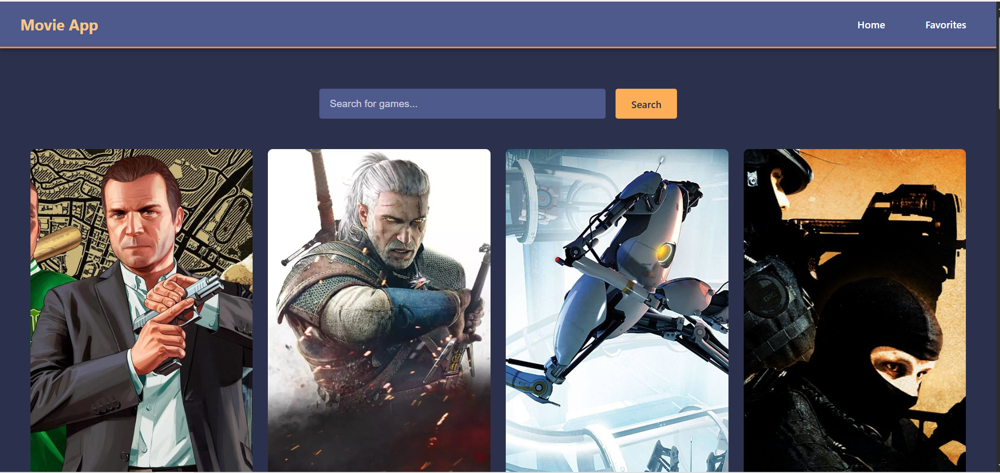

# Games App

Application web de recherche de jeux vidéo et de gestion de favoris, construite avec React et l'API RAWG.



## Fonctionnalités

- Liste des jeux populaires
- Recherche de jeux par titre
- Affichage de l'image, de l'année de sortie et de la note de chaque jeu
- Ajout et retrait de favoris, sauvegardés dans le navigateur (localStorage)
- Gestion des états de chargement et d'erreur
- Interface responsive

## Stack technique

React 19 · Vite · React Router · Context API · API RAWG

## Installation

```bash
git clone https://github.com/AYA-AMMI/react-games-app.git
cd react-games-app
npm install
cp .env.example .env
npm run dev
```

Renseignez ensuite votre clé dans le fichier `.env`.

## Variables d'environnement

| Variable            | Description                                                              |
| ------------------- | ------------------------------------------------------------------------ |
| `VITE_RAWG_API_KEY` | Clé API gratuite, à créer sur [rawg.io/apidocs](https://rawg.io/apidocs) |

## Scripts

| Commande        | Action                            |
| --------------- | --------------------------------- |
| `npm run dev`   | Lance le serveur de développement |
| `npm run build` | Génère la version de production   |
| `npm run lint`  | Vérifie le code avec ESLint       |

## Structure du projet

```
src/
├── components/   # GameCard, NavBar
├── contexts/     # GameContext (hook), GameProvider (favoris)
├── pages/        # Home, Favorites
├── services/     # api.js (appels RAWG)
└── css/          # Styles
```

## Améliorations prévues

- Page de détail d'un jeu (description, plateformes, captures d'écran)
- Filtres par genre et par plateforme
- Pagination et recherche avec debounce
- Fonctionnalité IA : recommandation de jeux similaires

## À propos

Projet réalisé à partir d'un tutoriel React sur les films (API TMDB), puis adapté aux jeux vidéo avec l'API RAWG et personnalisé : design et palette de couleurs, gestion des erreurs, refactoring des appels API, séparation du contexte et du provider.

## Crédits

Données fournies par [RAWG](https://rawg.io), la plus grande base de données de jeux vidéo.
